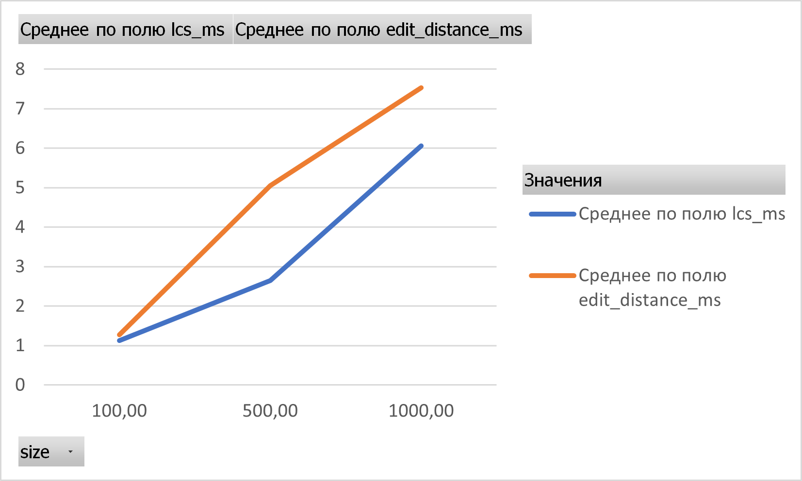
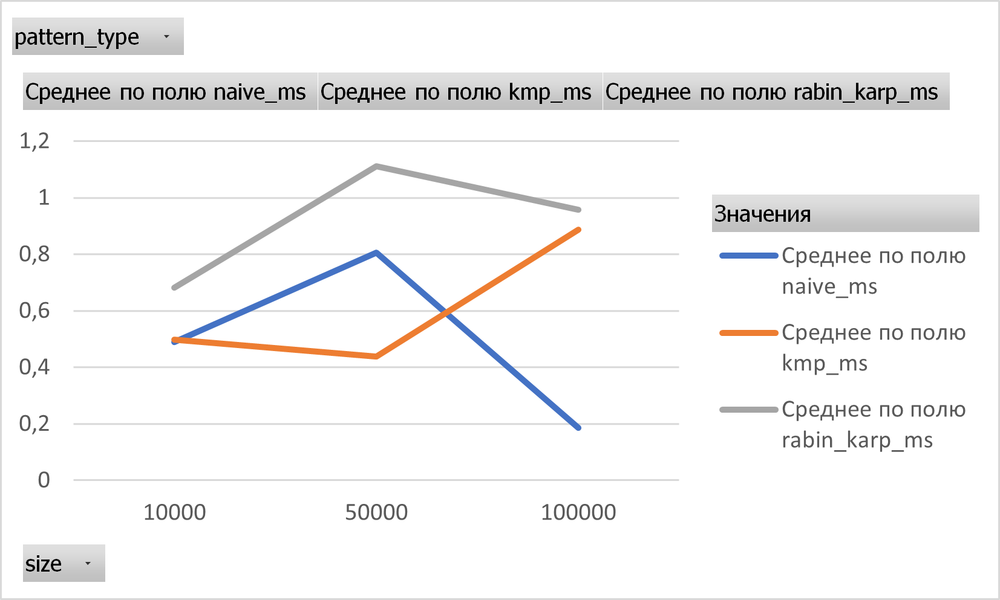

## Problem Description
The objective of this assignment is to implement, test, and experimentally evaluate several fundamental algorithms used in text analysis and string processing.

The project focuses on three major topics:
- Dynamic programming
- String matching algorithms
- Suffix arrays and Longest Common Prefix (LCP) computation

## Implemented Algorithms
- Longest Common Subsequence (LCS).
The LCS algorithm finds the length of the longest subsequence shared by two strings. A subsequence does not need to consist of consecutive characters.
The implementation uses dynamic programming with a two-dimensional table.
- Levenshtein Edit Distance.
The Edit Distance algorithm calculates the minimum number of insertions, deletions, and substitutions required to transform one string into another.
The implementation uses a dynamic programming table, where each cell represents the minimum edit distance between prefixes of the two input strings.
- Naive String Matching.
The Naive Search algorithm checks every possible position in the text to determine whether a given pattern occurs there.
It is simple to implement but may perform many repeated comparisons.
- Knuth–Morris–Pratt (KMP)
The KMP algorithm improves string matching by preprocessing the pattern and constructing an LPS (Longest Proper Prefix which is also Suffix) array.
The LPS array allows the algorithm to avoid unnecessary character comparisons.
- Rabin–Karp
The Rabin–Karp algorithm uses rolling hash values to identify possible pattern matches.
When the hash values match, the algorithm verifies the corresponding characters to avoid false matches caused by hash collisions.
- Kasai's Algorithm
Kasai's algorithm computes the Longest Common Prefix (LCP) array using a string and its suffix array.
It reuses information from previous comparisons to calculate the LCP array efficiently in linear time.

## Implementation Decisions
- LCS and Edit Distance use two-dimensional dynamic programming tables.
- String matching algorithms return the starting positions of all pattern occurrences.
- KMP preprocesses the pattern using an LPS array.
- Rabin–Karp uses hashing followed by character verification when hash values match.
- Kasai's algorithm receives a precomputed suffix array.
- A separate SuffixArray class is used to construct suffix arrays for experiments.
- SearchAnalysis and SearchMetrics are used to count character comparisons.
- ResultsExporter generates CSV files containing experimental measurements.
- Graphs are created manually in Microsoft Excel using PivotTables and PivotCharts.

## Assumptions
- Input strings are non-null.
- String matching is case-sensitive.
- Overlapping pattern occurrences are allowed.
- The algorithms operate on Java strings.
- Random experimental inputs contain lowercase English letters (a–z).
- A fixed random seed of 42 is used for reproducibility.
- The suffix array supplied to Kasai's algorithm is assumed to be valid.
- Edit Distance uses unit costs for insertion, deletion, and substitution.

## Complexity Analysis Table
Let:
- n = length of the first string or text
- m = length of the second string or pattern
- N = length of the string used by Kasai's algorithm

| Algorithm | Time Complexity | Space Complexity |
|---|---|---|
| LCS | O(n × m) | O(n × m) |
| Edit Distance | O(n × m) | O(n × m) |
| Naive Search | O(n × m) worst case | O(1) auxiliary |
| KMP | O(n + m) | O(m) auxiliary |
| Rabin–Karp | O(n + m) expected; O(n × m) worst case | O(1) auxiliary |
| Kasai | O(N) | O(N) |

For string matching, the returned list of match positions requires additional output space. Kasai's complexity excludes suffix array construction.

## Complexity Explanation
- LCS and Edit Distance: Both algorithms fill a dynamic programming table containing approximately n × m cells. Each cell requires constant-time operations, resulting in O(n × m) time complexity.
- Naive Search: In the worst case, the algorithm compares up to m characters at each possible starting position in the text.
- KMP: Pattern preprocessing takes O(m), and searching takes O(n), giving an overall time complexity of O(n + m).
- Rabin–Karp: Rolling hash updates are efficient, but hash collisions can require additional character comparisons.
- Kasai: The algorithm computes LCP values in linear time by reusing the length of previously matched prefixes.

## Testing Strategy
Correctness testing is performed using the AlgorithmTests.java class.
The tests cover typical inputs and important edge cases, including:
- Empty strings
- Identical strings
- Strings with no common characters
- Different string lengths
- Patterns occurring at the beginning or end of a text
- Patterns not occurring in a text
- Repeated and overlapping pattern occurrences
- Known suffix arrays and expected LCP values

For string matching, the results of Naive Search, KMP, and Rabin–Karp are compared to ensure that all three algorithms return identical match positions.

## Testing Results
| Algorithm | Testing Objective | Result |
|---|---|---|
| LCS | Verify subsequence lengths | PASS |
| Edit Distance | Verify minimum edit operations | PASS |
| Naive Search | Verify pattern positions | PASS |
| KMP | Verify pattern positions | PASS |
| Rabin–Karp | Verify pattern positions | PASS |
| Kasai | Verify LCP array values | PASS |

Total automated tests: 20 test cases in the prepared test suite.

Actual test execution result: 20 tests passed, 0 tests failed. All implemented algorithms passed the correctness tests successfully.

The test suite should be executed before the experimental measurements to confirm algorithm correctness.

## Input Sizes
LCS and Edit Distance are evaluated using pairs of random strings of equal lengths:
- 100 characters
- 500 characters
- 1,000 characters

Naive Search, KMP, and Rabin–Karp are evaluated using text lengths:
- 10,000 characters
- 50,000 characters
- 100,000 characters

Two pattern conditions are tested:
- present: the pattern is selected from the text.
- absent: the pattern contains characters that do not appear in the generated text.

Both patterns contain 10 characters.

Kasai's algorithm is evaluated using string lengths:
- 1,000 characters
- 5,000 characters
- 10,000 characters

## Timing Methodology
Execution time is measured using System.nanoTime(). Each algorithm is executed once for warm-up and then five times for measurement.
The average execution time is calculated as: Average Time = (t1 + t2 + t3 + t4 + t5) / 5.
The measured time is converted from nanoseconds to milliseconds.

Random input generation, suffix array construction for Kasai, CSV file writing, and console output are excluded from the timed sections.
The same generated input is reused across the five measured runs of each experiment.
Character comparison counts are collected separately for the string matching algorithms.

## LCS vs Edit Distance
| Input Size | LCS (ms) | Edit Distance (ms) |
|---|---|---|
| 100 | 1.124540 | 1.271160 |
| 500 | 2.647360 | 5.059520 |
| 1000 | 6.056160 | 7.531740 |

Execution Time: LCS vs Edit Distance

The experimental results show that the execution time of both LCS and Edit Distance increases as the input size grows from 100 to 1000 characters.
Edit Distance consistently takes more time than LCS in all three experiments.
Both algorithms use dynamic programming and have a theoretical time complexity of O(n × m).
The results are consistent with the expectation that larger inputs require more computation.

## String Matching Algorithms
The following table uses the present pattern condition.

| Text Length | Naive (ms) | KMP (ms) | Rabin–Karp (ms) |
|---|---|---|---|
| 10000 | 0.718360 | 0.714580 | 0.977180 |
| 50000 | 1.460920 | 0.722740 | 1.221960 |
| 100000 | 0.211980 | 1.455500 | 0.960260 |

 Execution Time: String Matching Algorithms

The experimental results show fluctuations in execution time.
KMP was the fastest algorithm for text lengths of 10000 and 50000 characters, while Naive Search was the fastest at 100000 characters.
These results demonstrate that actual execution time does not always increase consistently with input size, especially when measurements are affected by JVM optimizations and runtime conditions.

## Pattern Present vs Pattern Absent
The experiments also evaluate the algorithms when the pattern does not occur in the text.

| Text Length | Pattern Type | Naive (ms) | KMP (ms) | Rabin–Karp (ms) |
|---|---|---|---|---|
| 10000 | absent | 0.259780 | 0.280840 | 0.385060 |
| 50000 | absent | 0.149180 | 0.151580 | 0.999320 |
| 100000 | absent | 0.157880 | 0.317480 | 0.956120 |

For absent patterns, Naive Search and KMP generally performed faster than Rabin–Karp in these experiments.
The execution times were not strictly proportional to text length, possibly due to JVM optimization and system workload.
The CSV file also contains character comparison counts for the three string matching algorithms.

### Kasai's Algorithm
| Input Size | Kasai Execution Time (ms) |
|---|---|
| 1000 | 0.172220 |
| 5000 | 0.754560 |
| 10000 | 0.674400 |

Kasai's algorithm has a theoretical time complexity of O(N).
The execution time increased from 0.172220 ms to 0.754560 ms when the input size increased from 1000 to 5000 characters.
However, at 10000 characters, the execution time decreased slightly to 0.674400 ms.
This variation may be caused by JVM optimization, garbage collection, or system workload.
The measurements include only LCP construction, not suffix array construction.

## Theoretical vs Experimental Results
- Dynamic Programming Algorithms
Both LCS and Edit Distance have O(n × m) time complexity.
When both input strings have length n, this becomes O(n²).
The experimental graph shows increasing execution times for both algorithms as the input size grows.
Edit Distance is slower than LCS in the recorded measurements, even though the two algorithms share the same asymptotic complexity.
This difference may be explained by the number and type of operations performed in their dynamic programming transitions.
- String Matching Algorithms
The theoretical analysis predicts that Naive Search can require O(n × m) time in the worst case, while KMP guarantees O(n + m) time.
Rabin–Karp is efficient on average but can suffer from additional verification work when hash collisions occur.
However, the experimental graph does not show a consistent performance winner across all input sizes.
One important reason is that the experiments use random lowercase strings and short patterns. Such inputs may not trigger the worst-case behavior of Naive Search.
Additionally, Java execution time can be affected by JIT compilation, garbage collection, and other runtime factors.
Therefore, theoretical complexity provides an important explanation of how algorithms scale, while experimental measurements show their practical performance under specific conditions.
- Kasai's Algorithm
Kasai's algorithm has O(N) theoretical time complexity when the suffix array is already available.
Its linear-time behavior is achieved by reusing previous prefix comparison information.
The experimental results can be used to examine whether execution time increases approximately proportionally to string length.

## Conclusion
In this assignment, six text analysis algorithms were implemented, tested, and compared.
All 20 tests passed successfully. The experiments showed that LCS and Edit Distance require more time as input size increases, while string matching algorithms showed varying performance.
Naive Search is simple, KMP provides efficient linear-time matching, and Rabin–Karp uses hashing. Kasai efficiently computes the LCP array in linear time.
Overall, the main trade-offs are between execution time, memory usage, and implementation simplicity.